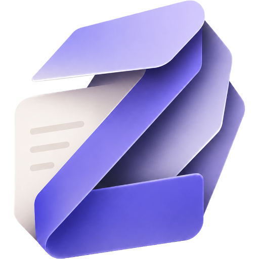

<div align="center">
  <a href="./assets/favicon.ico"></a>

  <h1>ZENdian</h1>

  <p><strong>把 Obsidian 变成兼顾项目管理、专注执行与长期写作的个人工作空间。</strong></p>

  <p>
    <a href="https://github.com/iJunkey-max/Zendian/releases/latest"></a>
    
    
    <a href="./LICENSE"></a>
  </p>

  <p>
    <a href="#核心能力">核心能力</a> ·
    <a href="#安装">安装</a> ·
    <a href="#快速开始">快速开始</a> ·
    <a href="#开发">开发</a> ·
    <a href="#支持项目">支持项目</a> ·
    <a href="https://github.com/iJunkey-max/Zendian/releases">版本发布</a>
  </p>
</div>

---

## 项目简介

ZENdian 是一款面向 Obsidian 的工作空间增强插件。它在不改变 Markdown 文件开放性的前提下，将项目主页、任务推进、时间线、交付物、专注记录与写作体验整合到同一套界面中。

它不仅是一组视觉样式，也是一套围绕“记录—执行—复盘”设计的工作流：

- 用智能首页汇总今日优先级、项目进度、日历、天气与专注数据；
- 用项目控制台集中管理任务、时间线、检查点和交付物；
- 用 `.home` 文件创建可随知识库同步和迁移的项目主页；
- 用模块化外观设置统一编辑器、文件树、标题、Callout、代码块等界面；
- 同时适配桌面端、平板与手机端，并支持 Obsidian 原生浅色/深色模式。

> [!IMPORTANT]
> ZENdian 当前要求 **Obsidian 1.12.7 或更高版本**。升级前建议备份知识库，并阅读 [V4.0.02 发布说明](./notes/RELEASE_NOTES_4.0.02.md)；项目数据迁移背景见 [V4.0.00 发布说明](./notes/RELEASE_NOTES_4.0.00.md)。

## 核心能力

### 智能首页

- 今日优先级、日历、天气和专注统计集中展示；
- 项目进度与最近活动概览；
- 首页卡片布局与模块显示可配置；
- 灵感速记支持绑定目录，便于快速归档；
- 针对移动端优化导航、卡片密度和触控交互。

### 项目工作空间

- 通过项目主页集中呈现项目状态与关键内容；
- 支持任务编辑、项目进度跟踪和长文本 Markdown 描述；
- 时间线与检查点提供新建、恢复和删除操作；
- 交付物可按项目分类配置目录，并支持打开、删除和旧目录兼容；
- 发布构建可生成包含 `main.js`、`manifest.json` 与 `styles.css` 的标准插件包。

项目管理使用稳定 `projectId` 识别项目，分类和显示名称独立于目录位置。直接在文件管理器或 Obsidian 文件树中移动、重命名项目文件夹后，启动核对器会按当前 `.home` 重新关联；“项目检查与关联”可处理缺失、重复、嵌套和根目录冲突。关闭 Obsidian 期间无法记录逐次操作，重新打开后只记录当前可验证的文件事实，具体规则见 [数据与恢复说明](./docs/项目数据与恢复.md)。

### 专注与复盘

- 在首页或项目场景中启动专注计时；
- 记录专注时长，并将结果汇总到工作空间；
- 结合任务、项目进度和时间线形成连续的复盘上下文。

### 阅读与写作体验

- 提供标题、正文、列表、表格、链接、引用、Callout 与代码块样式；
- 增强图片、嵌入内容、Canvas、Outline 和新标签页体验；
- 支持文件夹颜色、图标和层级视觉提示；
- 通过模块化设置控制布局、排版、色彩与自动隐藏行为。

### 主题与设备适配

- 基于 Obsidian 原生主题变量同步强调色；
- 支持原生浅色与深色模式切换；
- 不要求安装第三方主题；
- 为桌面端、平板和手机端提供响应式布局。

### 官方关系图谱美化

- 直接增强 Obsidian 官方全局图谱与局部图谱，不替换其数据、布局、按钮或鼠标交互；
- 节点颜色、形状、尺寸与聚焦状态完全沿用 Obsidian 官方样式，ZENdian 不再覆盖节点渲染；
- 使用丝状纹理蒙版、三层低透明度星云和静态星尘营造空间氛围；
- 桌面端提供缓慢星云漂移，移动端与“减少动态效果”模式自动静止；
- 官方搜索、筛选、分组、显示、力导向、拖拽和缩放功能保持不变；
- 自动向官方图谱过滤器追加 `-file:.home`，项目控制台文件及其关系边不会进入全局或局部图谱；
- 可从 **设置 → ZENdian → 工作区 → 关系图谱** 调整或完全关闭。

## 安装

### 方式一：从 GitHub Releases 安装

1. 打开 [最新版本发布页](https://github.com/iJunkey-max/Zendian/releases/latest)；
2. 下载发布包并解压；
3. 将以下文件放入知识库的 `.obsidian/plugins/zendian/` 目录：

   ```text
   main.js
   manifest.json
   styles.css
   ```

4. 重启 Obsidian，或重新加载社区插件；
5. 进入 **设置 → 第三方插件**，启用 **ZENdian**。

### 方式二：通过 BRAT 安装

1. 在 Obsidian 中安装并启用 BRAT；
2. 选择 **Add Beta plugin**；
3. 输入仓库地址：

   ```text
   https://github.com/iJunkey-max/Zendian
   ```

4. 安装完成后，在第三方插件列表中启用 ZENdian。

### 方式三：从源码构建

需要 Node.js 20 或更高版本，以及 npm。

```bash
git clone https://github.com/iJunkey-max/Zendian.git
cd Zendian
npm ci
npm run check
npm run build
```

构建产物位于 `dist/` 目录。

## 快速开始

1. 启用插件后，打开 **设置 → ZENdian**；
2. 按需要配置主页、项目、排版、文件树和界面模块；
3. 从功能区或命令面板进入 ZENdian 首页；
4. 创建或选择一个项目目录，生成项目主页；
5. 在项目主页中维护任务、时间线、检查点与交付物；
6. 使用专注计时和首页统计完成日常回顾。

项目主页使用 `.home` 文件保存。该文件属于知识库内容，可随同步、备份和版本管理工具一起迁移。

## 兼容性

| 项目 | 支持情况 |
| --- | --- |
| Obsidian | 1.12.7 及以上 |
| Windows / macOS / Linux | 支持 |
| iOS / Android | 支持，部分交互按移动端布局调整 |
| 浅色 / 深色模式 | 支持 |
| 第三方主题 | 不作为前置依赖；复杂主题可能覆盖部分样式 |
| Style Settings | 可选，用于进一步调整外观 |

由于 Obsidian 的界面结构会随版本变化，如果升级 Obsidian 后出现布局或交互异常，请先确认 ZENdian 已更新至最新版，再提交问题。

## 数据与隐私

- 项目主页、任务、时间线、检查点、交付物索引和插件设置保存在本地知识库或 Obsidian 插件数据中；
- ZENdian 不提供账户体系，也不会将知识库内容上传到自有服务器；
- 天气等需要实时信息的功能会在启用或使用时访问对应的外部服务；
- 卸载插件前，请先保留需要继续使用的 `.home` 文件及项目资料。

## 配置与升级

插件设置集中在 **设置 → ZENdian**。多数外观配置会即时应用，无需重启 Obsidian。

从旧版本升级时：

- 插件会尽可能迁移既有设置；
- V2 用户应先备份知识库，再升级至 V3；
- V3.2.02 会继续识别既有 `.home` 项目数据和旧交付物目录；
- V4.0.00 会为项目注册表与历史索引提供首次写入前备份；Vault 根目录 `.home` 需要移动到独立项目文件夹后再登记；
- 跨大版本升级前，请阅读 [更新日志](./CHANGELOG.md) 与对应发布说明。

## 开发

需要深入了解启动流程、模块/服务接口、数据存储和各文件职责时，请阅读 [开发者指南](./docs/开发者指南.md)。

### 常用命令

| 命令 | 说明 |
| --- | --- |
| `npm run dev` | 启动监听构建并生成 sourcemap |
| `npm run build` | 构建生产版 JavaScript 与 CSS |
| `npm run build:js` | 仅构建 TypeScript |
| `npm run build:css` | 仅合并并构建 CSS |
| `npm run typecheck` | 执行 TypeScript 类型检查 |
| `npm run check:settings` | 校验设置定义与设置界面映射 |
| `npm run check:safety` | 检查高风险代码模式 |
| `npm run check:projects` | 使用模拟 Vault 运行项目行为回归测试 |
| `npm run check` | 运行类型、契约和行为检查 |

提交代码前建议至少运行：

```bash
npm run check
npm run build
```

### 项目结构

```text
Zendian/
├─ assets/                 # README 与项目品牌资源
├─ css/                    # 设计系统、主题层和功能样式
├─ scripts/                # 构建与静态检查脚本
├─ src/
│  ├─ core/                # 事件、设置和模块生命周期
│  ├─ focus-clock/         # 专注计时与记录
│  ├─ homepage/            # 智能首页、项目控制台及领域服务
│  ├─ modules/             # 可独立加载/卸载的功能模块
│  ├─ services/            # 跨功能的数据同步与活动记录服务
│  ├─ types/               # TypeScript 类型与默认设置
│  ├─ ui/                  # 设置页、选择器及交互界面
│  └─ main.ts              # 插件入口
├─ manifest.json           # Obsidian 插件清单
└─ package.json
```

核心模块通过统一生命周期加载，并通过 CSS 类名和自定义属性驱动界面样式。功能代码负责状态与数据，CSS 负责最终呈现，以降低对 Obsidian 动态 DOM 结构的耦合。

## 支持项目

如果 ZENdian 改善了你的 Obsidian 工作流，可以通过微信或支付宝自愿赞赏，支持项目的持续维护、兼容性修复与功能改进。

<details>
  <summary><strong>查看微信与支付宝收款码</strong></summary>
  <br>
  <table>
    <tr>
      <th align="center">微信支付</th>
      <th align="center">支付宝</th>
    </tr>
    <tr>
      <td align="center"></td>
      <td align="center"></td>
    </tr>
  </table>
</details>

> 赞赏完全自愿，不会影响任何功能、版本更新或问题反馈。请在付款前核对收款信息。

## 反馈与贡献

欢迎通过 [GitHub Issues](https://github.com/iJunkey-max/Zendian/issues) 报告问题或提出建议。

提交问题时，请尽量附上：

- Obsidian 与 ZENdian 版本；
- 操作系统和设备类型；
- 是否使用第三方主题或相关插件；
- 可复现步骤、控制台错误和必要的界面截图。

Pull Request 应保持改动范围清晰，并确保 `npm run check` 与 `npm run build` 通过。

## 版本与许可

- 当前版本：**V4.0.02**
- [更新日志](./CHANGELOG.md)
- [V4.0.02 发布说明](./notes/RELEASE_NOTES_4.0.02.md)
- [V4.0.01Fix 发布说明](./notes/RELEASE_NOTES_4.0.01Fix.md)
- [V4.0.00 发布说明](./notes/RELEASE_NOTES_4.0.00.md)
- [V3.2.05 发布说明](./notes/RELEASE_NOTES_3.2.05.md)
- [V3.2.03 发布说明](./notes/RELEASE_NOTES_3.2.03.md)
- [V3.2.02 发布说明](./notes/RELEASE_NOTES_3.2.02.md)
- [V3.2.01 发布说明](./notes/RELEASE_NOTES_3.2.01.md)
- [V3.2.00 发布说明](./notes/RELEASE_NOTES_3.2.00.md)
- [V3.1.04 发布说明](./notes/RELEASE_NOTES_3.1.04.md)
- [V3.1.03 发布说明](./notes/RELEASE_NOTES_3.1.03.md)
- [全部版本发布](https://github.com/iJunkey-max/Zendian/releases)

本项目基于 [MIT License](./LICENSE) 开源。

---

<div align="center">
  <sub>Designed and maintained by <a href="https://github.com/iJunkey-max">Junkey</a>.</sub>
</div>
