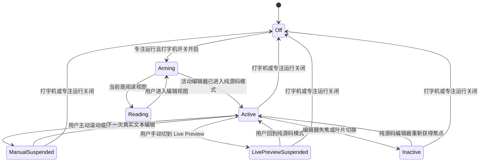

# ZENdian 打字机滚动重构方案

状态：设计完成，待实现  
日期：2026-07-26  
适用范围：Obsidian Markdown 编辑视图、ZENdian 专注模式与专注时钟

## 1. 结论

打字机模式应重构为一套“源码模式会话 + 固定焦点轨道 + 锚定内容动画”的组合机制：

1. 打字机模式只在纯源码模式中运行。开启后，当前 Markdown 编辑页和之后进入的 Markdown 编辑页默认切换到纯源码模式。
2. 当前编辑位置固定在编辑器可用高度的 55% 附近，称为“焦点轨道”。
3. 输入仍位于同一视觉行时不滚动；只有换行、自动折行或光标纵向移动导致视觉行变化时才重新定位。
4. 重新定位时先同步修正真实 `scrollTop`，保证光标立即位于焦点轨道；再只对非活动行播放一次 100ms 左右的视觉位移动画。因此编辑行和光标保持稳定，周围内容滑动。
5. 不再使用浏览器原生 `behavior: "smooth"`。所有动画可取消、可合并且同一编辑器最多存在一个。
6. 用户主动滚动、拖选、切换到 Live Preview、进入阅读视图或编辑器失焦时，自动滚动必须暂停，不能与用户争夺控制权。
7. 专注模式由设置开启和由专注时钟临时开启时，必须走同一个运行状态控制器。

## 2. 当前实现的问题

当前实现位于 `src/modules/editor-enhance.module.ts` 和 `css/base/border-theme.css`。

### 2.1 动画不断追赶

当前 `ViewPlugin.update()` 在每次 `selectionSet` 或 `docChanged` 后调用：

```ts
scrollDOM.scrollBy({ top: diff, behavior: "smooth" });
```

浏览器原生平滑滚动无法由插件可靠地合并和接管。连续输入时，上一段动画尚未完成，下一次滚动又开始，视觉上会产生追赶、回弹和速度不一致。

### 2.2 描述和实际位置不一致

设置说明是“光标保持在屏幕垂直中央”，当前代码却使用：

```ts
const targetY = scrollDOM.clientHeight * 0.75;
```

75% 的位置过低，视线容易受窗口底部、状态栏和输入法候选框干扰。

### 2.3 活动行样式会改变几何尺寸

当前活动行包含：

- `transform: scale(1.02)`
- `font-weight: 500`
- `padding: 4px`
- 模糊、阴影和 300ms 过渡

缩放会让行在焦点变化时跳动；加粗可能改变文字宽度并触发重新折行；上下内边距会改变行高。滚动算法正在追踪一个不断改变尺寸的位置，因此会进一步放大晃动。

### 2.4 Live Preview 中存在不同类型的编辑目标

Live Preview 会把表格、嵌入内容和部分 Markdown 结构替换成 Widget 或嵌套编辑控件。此时：

- `state.selection.main.head` 不一定代表屏幕中的真实输入点；
- `coordsAtPos()` 可能返回 Widget 边界、暂时返回 `null`，或与内部编辑控件不一致；
- Widget 渲染会改变高度，造成滚动位置二次变化。

将打字机模式限定为纯源码模式，可以把表格、引用、代码块和普通段落统一为 CodeMirror 文本行。

## 3. 设计目标

### 3.1 必须达到

- 光标和当前编辑视觉行在连续写作时稳定停留在固定位置。
- 换行时只看到周围内容移动，不看到活动行上下追赶。
- 表格、引用、代码块、列表、标题和普通文本使用同一套定位逻辑。
- 中文输入法组合输入不抖动、不重复滚动。
- 手动滚动后插件立即让出控制权。
- 多窗格和弹出窗口中的编辑器互不干扰。
- 关闭功能或卸载插件后不留下样式、动画、事件和临时视图状态。

### 3.2 不在本次范围

- 不在 Live Preview 中适配每一种 Widget。
- 不改变 Obsidian 的全局“默认编辑模式”配置。
- 不强制把阅读视图切换成编辑视图。
- 不复制编辑行、不伪造光标、不创建覆盖真实编辑器的镜像文本。
- 第一版不增加复杂的动画参数设置。

## 4. 核心交互规格

### 4.1 焦点轨道

- 默认位置：编辑器滚动区域可用高度的 55%。
- 位置根据每个编辑器的 `scrollDOM.clientHeight` 单独计算，不能使用 `window.innerHeight` 或固定 `vh`。
- 小窗格保护：
  - 距顶部至少 72px；
  - 距底部至少 96px；
  - 当可用高度小于 240px 时，改用 50% 且关闭视觉动画，只做同步定位。
- 焦点轨道是逻辑位置，不额外显示明显横线。
- 当前行可以保留轻微背景色或内描边，但样式不得改变行高、宽度、字重或换行结果。

计算公式：

```ts
const height = scrollDOM.clientHeight;
const anchorLocalY = clamp(height * 0.55, 72, height - 96);
const anchorScreenY = scrollRect.top + anchorLocalY;
```

### 4.2 普通输入

- 输入字符后，如果光标中心与焦点轨道误差不超过 2px，不产生滚动和动画。
- 同一视觉行内的横向移动不触发定位。
- 文档更新但编辑器没有焦点时不触发定位。

### 4.3 Enter 和自动折行

当光标进入新的视觉行：

1. 在 CodeMirror 的测量阶段读取光标矩形和滚动容器矩形。
2. 计算 `delta = caretCenterY - anchorScreenY`。
3. 在写入阶段立即执行受边界约束的 `scrollTop += delta`。
4. 光标因此在浏览器绘制前到达焦点轨道。
5. 将本次 `delta` 作为非活动行的临时视觉偏移。
6. 在约 100ms 内把临时偏移从 `delta` 缓动到 `0`。

最终感受是：新的编辑行停在原来的焦点位置，旧行和周围正文整体滑走。

### 4.4 键盘纵向导航

- 上下方向键、Page Up/Down、跳转命令导致光标移出焦点轨道时，重新定位一次。
- 光标仍在当前视觉行时不动。
- 跳转距离不超过约 2.5 个默认行高时，使用 80–110ms 动画。
- 跳转超过约 2.5 个行高、跨标题跳转或搜索跳转时，直接定位，不播放大范围扫屏动画。

### 4.5 鼠标点击与拖选

- 点击视口内其他位置时，第一次点击不立即抢回焦点轨道。
- 用户开始输入后，再将新的编辑位置恢复到焦点轨道。
- `pointerdown` 到 `pointerup` 期间视为拖选，完全暂停自动定位。
- 非空选区存在时不播放非活动行位移动画，避免选区背景和文本分离。

### 4.6 手动滚动

以下事件进入 `manual-suspended`：

- 鼠标滚轮；
- 触控滚动；
- 拖动滚动条；
- 中键滚动。

规则：

- 暂停后不使用固定超时自动抢回。
- 下一次真实文本输入、删除、粘贴、撤销或重做时恢复。
- 恢复时如果光标距离焦点轨道超过 3 个行高，直接定位，不播放长距离动画。
- 插件自己修改 `scrollTop` 产生的 `scroll` 事件必须通过内部标记忽略。

### 4.7 中文输入法

- `view.composing` 为 `true` 时，只更新目标位置，不反复启动动画。
- 组合输入仍在同一视觉行时完全不动。
- 组合输入触发自动折行时可以同步修正 `scrollTop`，但动画合并到一次。
- `compositionend` 后执行最终测量，清除累计误差。

### 4.8 粘贴、撤销和大范围修改

- 单行或少量文本变更：按普通换行处理。
- 一次插入或删除超过 3 个视觉行：直接定位，不播放大段正文扫过屏幕的动画。
- 格式化命令或外部插件更新文档但编辑器未聚焦：不定位。

## 5. 源码模式会话

### 5.1 模式识别

每个 Markdown `WorkspaceLeaf` 独立识别：

| 状态 | `mode` | `source` | 打字机行为 |
|---|---|---|---|
| 阅读视图 | `preview` | 任意 | 不切换、不运行 |
| Live Preview | `source` | `false` 或缺省 | 启用会话时切到纯源码 |
| 纯源码模式 | `source` | `true` | 可以运行 |

`ViewState.state` 是开放记录，具体字段必须在当前 Obsidian 版本中通过 DevTools 比较切换前后的 `leaf.getViewState()` 再确认。实现不得依赖未经确认的内部 DOM 结构或命令 ID。

### 5.2 开启打字机模式

1. 计算运行条件：

```ts
typewriterRuntimeActive =
  focusRuntimeActive &&
  settings.editorEnhance.focusModeTypewriter;
```

2. 如果活动叶片是 Markdown 阅读视图，保持不变。
3. 如果活动叶片是 Live Preview：
   - 记录其原始模式；
   - 使用 `WorkspaceLeaf.setViewState()` 切换为纯源码模式；
   - 保留文件、临时状态、光标和导航历史；
   - 等待新编辑器实例稳定后再启动定位。
4. 如果已经是纯源码模式，直接激活。
5. 之后每次 `active-leaf-change`、`file-open` 或相关 `layout-change` 都重新判断活动叶片。

只处理活动叶片，避免后台分栏突然重绘；CodeMirror 插件也必须要求 `view.hasFocus` 才运行。

### 5.3 用户手动切回 Live Preview

- 当前叶片立即进入 `live-preview-suspended`。
- 清理该编辑器的临时偏移、动画和可用标记。
- 不反复强制切回源码模式。
- 只显示一次轻量提示：“打字机滚动已暂停，仅在源码模式中运行。”
- 用户手动回到源码模式后，该叶片自动恢复打字机滚动。
- 重新关闭再开启打字机模式时，视为新会话，可以再次默认切到源码模式。

### 5.4 关闭和恢复

每个被插件切换的叶片保存：

```ts
interface SourceModeRecord {
  originalWasSource: boolean;
  switchedByPlugin: boolean;
  manuallyOverridden: boolean;
  filePathAtSwitch: string | null;
}
```

关闭打字机模式时：

- 仅恢复 `switchedByPlugin === true` 且 `manuallyOverridden === false` 的叶片；
- 仅当叶片仍为纯源码模式时恢复；
- 用户在会话期间主动改变过模式时，不覆盖用户选择；
- 关闭阅读视图、已销毁叶片或已更换为非 Markdown 视图时，只删除记录；
- 插件卸载执行同样的恢复和清理。

不得修改 Obsidian 全局 `livePreview` 偏好。

## 6. 锚定内容动画

### 6.1 为什么不直接动画 `scrollTop`

如果对 `scrollTop` 做 100ms 插值，光标会在这 100ms 内从旧位置移动到焦点轨道，仍然违背“编辑行固定”的目标。

推荐采用 FLIP 思路，但不变换整个 `.cm-content`：

1. 真实滚动位置同步跳到最终值，光标立即固定。
2. 给当前编辑器所有非活动 `.cm-line` 应用共享的临时 `translateY(offset)`。
3. 活动 `.cm-line.cm-active` 和 CodeMirror 光标层不应用该偏移。
4. 把 `offset` 从本次滚动差值衰减到 0。

建议在每个 `EditorView.dom` 上维护：

```css
--zendian-typewriter-content-offset: 0px;
```

概念样式：

```css
.focus-mode-typewriter [data-zendian-typewriter-active] .cm-line:not(.cm-active) {
  transform: translateY(var(--zendian-typewriter-content-offset));
}

.focus-mode-typewriter [data-zendian-typewriter-active] .cm-line.cm-active {
  transform: none;
}
```

这样真实文档和光标已经处于最终位置，只有周围内容补播一段短位移动画。

### 6.2 动画参数

- 默认时长：100ms。
- 合法范围：80–120ms。
- 缓动：单调 ease-out，例如 `cubic-bezier(0.2, 0.7, 0.2, 1)`。
- 不使用弹簧、回弹、过冲和延迟。
- 位移大于 2.5 个默认行高时：时长为 0。
- `prefers-reduced-motion: reduce` 时：时长为 0。

### 6.3 连续换行合并

每个编辑器只有一个 `MotionCoordinator`：

```ts
interface MotionState {
  frame: number | null;
  currentOffset: number;
  targetOffset: 0;
  startedAt: number;
  duration: number;
}
```

新换行发生时：

- 取消旧 `requestAnimationFrame`；
- 计算旧动画当前尚未消耗的 `currentOffset`；
- `startOffset = currentOffset + newDelta`；
- 从新的 `startOffset` 继续衰减到 0；
- 不排队、不叠加多个动画。

动画结束、模式暂停、编辑器失焦或插件卸载时，必须将变量恢复为 `0px`。

### 6.4 安全降级

如果检测到以下情况，关闭本次视觉动画，但仍同步固定光标：

- 当前存在非空选区或多光标；
- 视口高度过小；
- 光标矩形无效；
- 位移过大；
- 编辑器正处于重配置或销毁；
- 非活动行变换与第三方插件发生冲突。

视觉动画是增强层，固定光标定位才是核心功能。动画失败不能让滚动功能失效。

## 7. 光标定位与滚动算法

### 7.1 定位顺序

由于第一版只在纯源码模式运行，定位链可以保持简单：

1. `view.coordsAtPos(selection.main.head, selection.main.assoc || 1)`；
2. 如果返回无效值，尝试另一侧 `assoc`；
3. 仍失败时，用 `view.lineBlockAt(head)` 和 `view.documentTop` 计算所属文本块中心；
4. 全部失败时跳过本帧，不滚动。

引用、表格源码、代码块、列表和标题不得分别写选择器。

### 7.2 测量与写入

所有 DOM 读取和写入必须通过 `EditorView.requestMeasure()` 分离：

```ts
view.requestMeasure({
  key: TYPEWRITER_MEASURE_KEY,
  read(view) {
    // 只读取 selection、coords、rect、scrollTop、clientHeight、scrollHeight
    return measurement;
  },
  write(measurement, view) {
    // 只写 scrollTop、CSS 变量和运行状态
  },
});
```

相同 `key` 的测量请求会自动合并，只执行最后一次。

### 7.3 边界

```ts
const desired = clamp(
  scrollDOM.scrollTop + delta,
  0,
  scrollDOM.scrollHeight - scrollDOM.clientHeight,
);
const appliedDelta = desired - scrollDOM.scrollTop;
```

视觉偏移必须使用 `appliedDelta`，不能使用未经过边界裁剪的原始 `delta`。

### 7.4 首尾留白

要让第一行和最后一行都能到达 55% 焦点轨道，需要提供上下滚动空间。

推荐在 CodeMirror 扩展中加入两个块级 Spacer Widget：

- 文档开头：高度约为 `anchorLocalY - caretHeight / 2`；
- 文档结尾：高度约为 `clientHeight - anchorLocalY - caretHeight / 2`。

Spacer：

- `aria-hidden="true"`；
- `pointer-events: none`；
- 不可编辑；
- 不改变文档内容和位置；
- 高度通过每个编辑器的 CSS 变量设置；
- 编辑器尺寸变化后调用 `requestMeasure()` 让 CodeMirror 更新几何信息。

不再使用当前 `.cm-scroller { padding-bottom: 75vh; }`，因为它只解决文档尾部、依赖窗口高度且与实际编辑器窗格不一致。

## 8. 事件分类

每次 `ViewUpdate` 先分类，再决定是否测量：

| 原因 | 示例 | 是否恢复自动定位 | 是否动画 |
|---|---|---:|---:|
| `input` | 输入、自动补全 | 是 | 小位移时是 |
| `delete` | Backspace、Delete、剪切 | 是 | 小位移时是 |
| `undo` / `redo` | 历史操作 | 是 | 小范围是 |
| `input.paste` | 粘贴 | 是 | 大范围否 |
| `select.pointer` | 鼠标点击/拖选 | 否 | 否 |
| `select` | 键盘移动 | 保持当前状态 | 仅小范围 |
| `geometryChanged` | 窗格缩放、字体变化 | 否 | 否 |
| 外部程序修改 | 后台同步 | 否 | 否 |

判断使用 `transaction.isUserEvent()`，不根据按键名称猜测。

## 9. 运行状态机



## 10. 模块架构

建议把当前单文件逻辑拆成以下职责：

### 10.1 `EditorEnhanceModule`

保留在 `src/modules/editor-enhance.module.ts`，负责：

- 读取持久化设置；
- 订阅专注时钟的临时运行请求；
- 计算 `focusRuntimeActive` 和 `typewriterRuntimeActive`；
- 切换全局主题类；
- 启停源码模式会话；
- 只注册一次 CodeMirror 扩展。

### 10.2 `FocusModeRuntime`

建议新增 `src/modules/editor-enhance/focus-mode-runtime.ts`：

```ts
interface FocusModeRuntimeState {
  persistent: boolean;
  clockTemporary: boolean;
  active: boolean;
  typewriterActive: boolean;
}
```

统一处理：

```ts
active = persistent || clockTemporary;
typewriterActive = active && settings.focusModeTypewriter;
```

`FocusClockController` 不再直接增删 `border-focus-mode` 和 `focus-mode-typewriter`，而是通过事件总线发出临时运行请求。

建议新增事件：

```ts
FOCUS_MODE_TEMPORARY_CHANGED: "focus-mode:temporary-changed"
```

### 10.3 `SourceModeSession`

建议新增 `src/modules/editor-enhance/source-mode-session.ts`，负责：

- 监听活动叶片和布局变化；
- 识别阅读、Live Preview 和纯源码状态；
- 安全切换活动编辑页；
- 标记具备打字机资格的叶片；
- 记录并恢复插件造成的模式变化；
- 防止 `setViewState()` 自身触发的事件被误判为用户手动切换。

### 10.4 `TypewriterViewPlugin`

建议新增 `src/modules/editor-enhance/typewriter.extension.ts`，每个 `EditorView` 拥有独立状态：

```ts
interface TypewriterViewState {
  enabled: boolean;
  suspension: "none" | "manual-scroll" | "pointer-selection" | "live-preview";
  programmaticScroll: boolean;
  lastCaretCenterY: number | null;
  measurePending: boolean;
  composing: boolean;
  motion: MotionState;
}
```

负责：

- 事件分类；
- 光标测量；
- 边界裁剪；
- 同步滚动；
- 非活动行视觉偏移动画；
- Spacer Widget；
- 每个视图的资源清理。

### 10.5 CSS

`css/base/border-theme.css` 需要：

- 删除 `75vh` 底部留白；
- 删除或覆盖活动行的缩放、加粗和内边距；
- 打字机模式下取消非活动行 blur；
- 保留不改变几何尺寸的透明度、背景和内描边；
- 添加非活动行共享偏移变量规则；
- 添加 `prefers-reduced-motion` 降级；
- 添加 Spacer Widget 样式。

## 11. 样式规格

### 11.1 打字机模式活动行

允许：

- `opacity: 1`
- 轻微背景色；
- `box-shadow: inset ...`；
- 不改变尺寸的圆角；
- 100–140ms 的颜色和透明度过渡。

禁止：

- `scale`
- 修改 `font-weight`
- 修改 padding、margin、line-height
- blur
- 弹性和回弹动画
- 对 `transform` 同时使用 CSS transition 和 JS 动画

### 11.2 非活动行

- 仅使用用户设置的透明度降噪；
- 打字机模式滚动期间不使用 blur，避免运动拖影；
- 共享 `translateY()` 仅用于短暂的内容滑动；
- 动画结束必须恢复 `translateY(0)`。

### 11.3 代码块

- 源码模式下按普通文本行定位；
- 保留代码块自身背景连续性；
- 活动行不能改变代码块圆角、padding 或块高度；
- 仅用透明度或内描边表示当前编辑位置。

## 12. 设置界面

第一版复用现有开关，不新增必需配置。

建议将说明改为：

> 打字机滚动：编辑时自动使用源码模式，并将当前输入位置固定在视口约 55% 处；换行时周围内容轻柔滑动。手动滚动或切换到实时预览时会暂时暂停。

可在稳定后增加两个高级选项：

- 焦点位置：40%–70%，默认 55%；
- 内容滑动：轻柔 / 关闭，默认轻柔。

高级选项不应阻塞第一版实现。

## 13. 与专注时钟的关系

当前专注时钟临时开启专注效果时直接操作 DOM 类，这会绕过源码模式会话。

重构后：

1. 专注时钟开始并需要临时专注时，发出 `FOCUS_MODE_TEMPORARY_CHANGED(true)`。
2. `EditorEnhanceModule` 统一计算运行状态。
3. 如果打字机开关开启，启动源码模式会话。
4. 专注或休息结束时发出 `false`。
5. 若用户原本已永久开启专注模式，临时请求结束后仍保持运行。
6. 只有运行状态真正从 active 变成 inactive 时才恢复源码模式记录。

## 14. 兼容与异常处理

### 14.1 多窗格

- 每个 `EditorView` 独立保存滚动和动画状态。
- 只有当前获得焦点的编辑器运行。
- 切换窗格时取消旧编辑器动画，但保留其滚动位置。

### 14.2 弹出窗口

- 使用编辑器元素自己的 `ownerDocument.defaultView.requestAnimationFrame()`。
- 不使用主窗口的 `window` 计算尺寸或调度动画。

### 14.3 阅读视图

- 不切换、不滚动、不增加 Spacer。
- 用户进入编辑视图后再判断是否需要切换为纯源码模式。

### 14.4 折叠内容

- 光标位于可见文本时正常运行。
- 展开折叠导致 `geometryChanged` 时只同步校正，不播放动画。
- 坐标无效时跳过当前帧。

### 14.5 第三方插件

- 不根据表格、代码块、引用块类名分别处理。
- 不修改文档内容。
- 不修改 Obsidian 全局编辑偏好。
- CSS 偏移只作用于带有 `data-zendian-typewriter-active` 标记的编辑器。
- 检测到外部 transform 冲突时自动关闭视觉动画，保留同步定位。

### 14.6 移动端

- 使用实际 `scrollDOM.clientHeight`，可适应软键盘出现后的视口。
- `compositionStarted` 长时间为 true 时不能永久禁止定位，应以视觉行变化为准。
- 触控滚动进入 `manual-suspended`。
- 小视口默认关闭视觉滑动，仅保持同步定位。

## 15. 性能预算

- 每个 `ViewUpdate` 最多安排一次带固定 `key` 的测量。
- 同一帧只读取一次光标矩形和滚动容器矩形。
- 同一编辑器最多一个 RAF 动画。
- 不遍历全文 DOM；偏移通过编辑器级 CSS 变量应用。
- 不用 `MutationObserver` 监听编辑器内容。
- 编辑器失焦、不可见或功能暂停时不测量。
- 目标：打字期间不产生持续 Layout Thrashing，60Hz 屏幕上不出现多帧长任务。

## 16. 验收测试矩阵

### 16.1 基础写作

- 文档首行输入。
- 文档中部连续输入 200 字。
- 连续按 Enter 20 次。
- 连续 Backspace 跨行删除。
- 长段落自动折行。
- 文档最后一行输入。

预期：光标中心稳定在焦点轨道 ±2px；同一视觉行输入不滚动；换行只有一次短动画。

### 16.2 Markdown 结构

- 六级标题。
- 有序、无序和多级列表。
- 引用块及多级引用。
- 围栏代码块与长代码行。
- Markdown 源码表格的每一列。
- 任务列表、脚注、数学公式源码。
- YAML frontmatter。

预期：全部使用同一坐标算法，不出现结构特定失效。

### 16.3 操作类型

- 鼠标点击其他行后继续输入。
- 鼠标拖选。
- 滚轮、触控板和拖动滚动条。
- 上下方向键、Page Up/Down。
- 粘贴多行文本。
- 撤销和重做。
- 搜索结果跳转。
- 中文拼音组合输入和候选词确认。

### 16.4 模式生命周期

- Live Preview 中开启打字机模式。
- 纯源码模式中开启。
- 阅读视图中开启。
- 手动切回 Live Preview。
- 手动回到纯源码。
- 关闭打字机模式。
- 插件卸载与重新加载。
- 专注时钟临时启用和结束。

### 16.5 布局

- 单窗格、左右分栏、上下分栏。
- 窗格缩放。
- 弹出窗口。
- 全屏与窗口模式。
- 不同字体大小和行高。
- `prefers-reduced-motion`。

## 17. 自动化与契约检查

项目目前没有完整 UI 测试框架，建议至少增加以下静态和单元级检查：

1. 源码中禁止再次出现 `behavior: "smooth"` 的打字机滚动。
2. 打字机活动行样式不得包含 `scale`、字重变化和几何 padding。
3. `FocusClockController` 不得直接修改专注模式 DOM 类。
4. 动画控制器在暂停、销毁和异常路径中都必须将偏移清零。
5. 纯函数测试：
   - 焦点轨道计算；
   - 滚动边界裁剪；
   - 大位移动画降级；
   - 连续动画偏移合并；
   - 运行状态合并；
   - 模式恢复判定。

运行时验证仍需在测试 Vault 中通过 DevTools 记录：

- 光标 Y 坐标；
- 目标轨道 Y 坐标；
- 每次应用的滚动差值；
- 同一编辑器的活动动画数量；
- Live Preview 与纯源码切换前后的叶片状态。

调试日志只在开发模式启用，发布构建关闭。

## 18. 分阶段实施

### 阶段 A：运行状态与源码模式

- 引入统一专注运行状态。
- 专注时钟改为发事件。
- 实现 `SourceModeSession`。
- 确认当前 Obsidian 版本的 `ViewState` 字段和状态恢复。

完成标准：所有激活路径都能一致进入纯源码；退出后不覆盖用户手动选择。

### 阶段 B：稳定锚定

- 移除原生 smooth。
- 实现每视图测量、同步 `scrollTop` 和首尾 Spacer。
- 暂不加入内容滑动动画。

完成标准：所有验收内容中光标稳定，无追赶、无特殊块失效。

### 阶段 C：锚定内容动画

- 加入非活动行共享视觉偏移。
- 实现 100ms 动画、连续换行合并和 reduced-motion。
- 添加安全降级。

完成标准：活动行保持稳定，周围内容滑动，快速输入不叠加动画。

### 阶段 D：交互收尾

- 完成手动滚动、拖选、IME、多窗格和弹出窗口。
- 更新设置说明。
- 建立静态契约和纯函数测试。
- 在测试 Vault 完成全矩阵回归。

## 19. 完成定义

只有同时满足以下条件才算完成：

- 打字机模式所有入口都统一使用纯源码模式会话；
- 普通输入、Enter、自动折行、引用、表格源码和代码块均稳定；
- 活动行没有任何几何尺寸动画；
- 用户滚动和模式切换不会被插件争夺；
- 中文输入法、多窗格、弹出窗口和 reduced-motion 已验证；
- 专注时钟与永久专注设置使用同一运行状态；
- 插件关闭和卸载能完整恢复临时状态；
- 完整构建、类型检查、契约检查和测试 Vault 手动验收全部通过。
