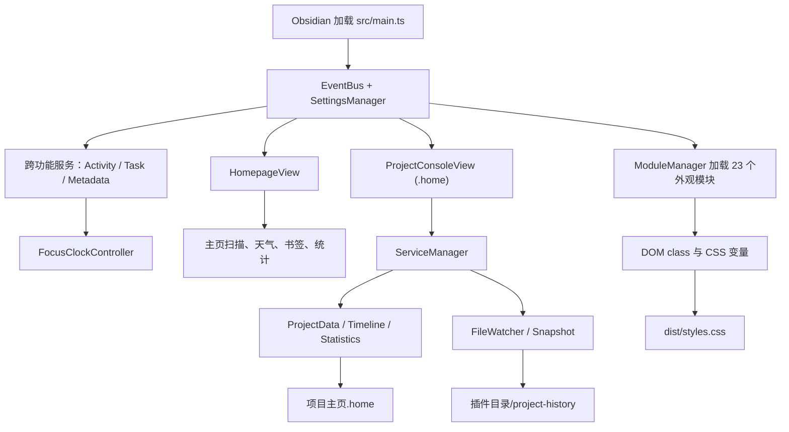

# ZENdian 开发者指南

> 适用版本：3.2.04 及当前 `main` 分支。本文描述插件代码架构；`docs/系统架构.md` 描述的是用户 Vault 的目录规划，两者用途不同。

## 1. 五分钟了解项目

ZENdian 是一个非桌面端限定的 Obsidian 插件，使用 TypeScript 和 esbuild 构建。它包含两类能力：

- 工作空间外观模块：通过 `document.body` 上的 class、CSS 自定义属性和少量 DOM 观察器增强 Obsidian UI。
- 生产力功能：主页、项目控制台、结构化任务、项目时间线、历史快照、交付物发布、数据统计和专注计时。

开发环境需要 Node.js 20 或更高版本：

```bash
npm ci
npm run check
npm run build
```

常用命令：

| 命令 | 用途 |
| --- | --- |
| `npm run dev` | 监听 TypeScript 变化，输出带内联 sourcemap 的 `dist/main.js` |
| `npm run build` | 依次构建 `dist/styles.css` 和生产版 `dist/main.js` |
| `npm run typecheck` | 严格类型、未使用代码和不可达代码检查 |
| `npm run check:settings` | 检查设置类型、默认值与设置 UI 契约 |
| `npm run check:safety` | 检查高风险路径、缓存与生命周期代码模式 |
| `npm run check` | 运行全部静态检查 |

生产发布需要 `dist/main.js`、`dist/styles.css` 和根目录的 `manifest.json`。

## 2. 总体架构



架构边界：

1. `src/main.ts` 只负责组装、注册 Obsidian View/命令和生命周期清理。
2. `src/core/` 提供事件、设置和模块生命周期，不包含具体界面功能。
3. `src/modules/` 是可独立加载和卸载的外观功能。
4. `src/homepage/` 包含主页、项目控制台及其领域服务。
5. `src/services/` 放置跨主页和控制台使用的服务。
6. TypeScript 管理状态、数据和 CSS 变量；最终视觉尽量由 CSS 完成。

## 3. 启动与卸载流程

`ZENdianPlugin.onload()` 的执行顺序：

1. 创建 `EventBus`。
2. 创建并初始化 `SettingsManager`，加载和迁移插件设置。
3. 创建 `ModuleManager`，注入 App、设置读取器和 CodeMirror 扩展注册器。
4. 加载活动日志、任务同步、项目元数据和专注时钟。
5. 注册并并行加载 23 个功能模块。
6. 注册主页、项目控制台、创建项目/任务和通用弹出表单 View。
7. 将 `.home` 扩展名绑定到项目控制台。
8. 注册 Ribbon 图标、命令、空标签页替换、主题变化与 Vault 活动监听。
9. 注册设置页。

卸载时会：停止专注时钟、触发设置和活动日志落盘、销毁项目服务单例、卸载全部模块并清空事件监听。新增长期监听器、计时器或 Observer 时，必须在对应 `unload()`/`destroy()` 中对称清理。

## 4. 核心接口

### 4.1 功能模块接口

所有 `src/modules/*.module.ts` 实现 `IFeatureModule`：

```ts
interface IFeatureModule {
  readonly id: string;
  readonly name: string;
  load(ctx: ModuleContext): Promise<void>;
  unload(): void;
  onSettingsChanged?(changedKeys: string[], settings: PluginSettings): void;
  onThemeChange?(isDark: boolean): void;
}
```

`ModuleContext` 提供：

| 成员 | 说明 |
| --- | --- |
| `events` | 插件内部事件总线 |
| `getSettings()` | 获取完整设置对象 |
| `getSetting(key)` | 获取一个顶层设置组 |
| `registerEditorExtension(ext)` | 注册 CodeMirror 6 扩展 |
| `app` | Obsidian `App` 实例 |
| `updateSettings(updates)` | 批量更新、持久化并广播设置 |

模块约定：`load()` 必须可安全调用一次；`unload()` 必须清理自己添加的 class、CSS 变量、DOM 节点、事件、Timer 和 Observer。

### 4.2 事件接口

`EventBus.on()` 返回取消订阅函数。当前事件定义在 `Events`：

| 事件 | 参数 | 触发时机 |
| --- | --- | --- |
| `settings:changed` | `changedKeys, settings` | 设置持久化后 |
| `theme:changed` | `isDark` | Obsidian `css-change` 后 |
| `activity:stats-changed` | 无 | 活动/专注统计变化后 |

事件处理器异常会被隔离并记录，不会阻断其他监听器。

### 4.3 设置接口

`PluginSettings` 和 `DEFAULT_SETTINGS` 是设置系统的唯一数据契约。顶层设置组包括外观模块以及 `homepage`、`banner`、`iconSystem` 等配置。

```ts
const settings = settingsManager.getSettings();
await settingsManager.update("homepage", { enabled: true });
await settingsManager.updateMultiple({
  autoHide: { ...settings.autoHide, ribbon: true },
  homepage: { ...settings.homepage, enabled: true },
});
```

写入采用 200ms 防抖和串行队列；卸载前调用 `flush()`。不要直接修改设置后绕过 `SettingsManager` 保存，否则模块收不到变更事件。

### 4.4 项目服务入口

项目控制台通过单例服务管理器访问领域服务：

```ts
const services = getServiceManager(app, taskSyncService);
await services.initialize();

const data = await services.projectData.getProjectConsoleData(projectPath);
const timeline = await services.timeline.getProjectTimeline(projectPath);
const stats = await services.statistics.getTaskStatistics(projectPath);
await services.trackProjectSnapshots(projectPath);
```

`ServiceManager` 的主要公开入口：

| API | 说明 |
| --- | --- |
| `initialize()` | 幂等初始化服务集合 |
| `trackProjectSnapshots(path)` | 初始化项目基线并监听后续变化 |
| `getProjectFullData(path)` | 聚合元数据、统计、健康度、时间线和任务/交付物统计 |
| `getProjectDashboardData(path)` | 获取仪表盘所需摘要 |
| `getProjectAnalytics(path)` | 获取趋势、文件类型和周/月报告 |
| `clearProjectCache(path)` | 清除指定项目的相关缓存 |
| `destroy()` | 解绑事件、结束编辑会话并清理缓存 |

`ProjectDataService` 提供 `.home` 数据、任务、交付物、文件统计和缓存 API。并发修改优先使用 `mutateProjectConsoleData()`，它最终通过 `mutateProjectHome()` 按项目串行化“重新读取—修改—写入”，避免多个 UI 操作互相覆盖。

### 4.5 任务接口

`TaskSyncService` 只读写 `项目主页.home` 中的 `tasks` 数组。对外优先级为 `urgent/high/medium/low`，存储层优先级为 `P0/P1/P2/P3`，服务会负责转换。

主要 API：`getTasks()`、`getTaskStats()`、`addTask()`、`updateTask()`、`toggleTask()`、`deleteTask()`。调用更新接口时应传稳定任务 ID/`raw` 值，避免基于过期数组索引覆盖其他修改。

### 4.6 项目主页存储接口

项目的事实来源是项目根目录中的 `项目主页.home`，内容为 JSON，核心结构为：

```ts
interface ProjectConsoleData {
  name: string;
  icon: string;
  description: string;
  type: string;
  createdAt: string;
  status?: ProjectStatus;
  statusHistory?: ProjectStatusHistoryEntry[];
  metadata?: { priority?: string; tags?: string[]; deadline?: string };
  tasks: ProjectConsoleTask[];
  deliverables: ProjectConsoleDeliverable[];
  overview?: { markdown: string };
  timeline?: { milestones: ProjectConsoleMilestone[] };
}
```

存储入口：

- `loadProjectHome()`：读取、补齐默认字段，并迁移旧 `Overview.md`/`Timeline.md`。
- `saveProjectHome()`：按项目写入队列保存完整数据。
- `mutateProjectHome()`：推荐的原子式修改入口。
- `findProjectHomeFile()`：兼容查找旧位置/命名。

旧 Markdown 数据迁移成功写入 `.home` 后，旧文件会进入 Vault 回收站，而不是永久删除。

## 5. 数据位置

| 数据 | 位置 | 负责人 |
| --- | --- | --- |
| 插件设置 | Obsidian `Plugin.loadData/saveData` 对应数据文件 | `SettingsManager` |
| 项目数据 | `<项目根目录>/项目主页.home` | `ProjectHomeStore` |
| 首页便签与格言 | `<configDir>/plugins/zendian/homepage-data.json` | `HomepageDataService` |
| 活动与专注记录 | `<configDir>/plugins/zendian/` 下的活动数据文件 | `ActivityLogService` |
| 项目历史索引 | `<configDir>/plugins/zendian/project-history/index.json` | `ProjectSnapshotService` |
| 历史内容 Blob | `<configDir>/plugins/zendian/project-history/blobs/` | `ProjectSnapshotService` |
| 第三方图标 | `<configDir>/plugins/zendian/icons/` | `IconSystemModule` |
| 生产构建 | `dist/main.js`、`dist/styles.css` | esbuild / `build-css.mjs` |

快照仅处理白名单文本扩展名，单文件上限 1 MiB；每个文件自动版本最多保留 30 个。交付物目录由项目分类设置解析，并通过 `DeliverablePathRegistry` 从普通项目文件统计和快照流程中排除。

## 6. 文件职责索引

### 6.1 根目录、构建与检查

| 文件 | 职责 |
| --- | --- |
| `package.json` | npm 依赖和构建/检查命令 |
| `package-lock.json` | npm 可重复安装锁文件 |
| `manifest.json` | Obsidian 插件 ID、版本、最低 App 版本和移动端声明 |
| `versions.json` | 插件版本与最低 Obsidian 版本映射 |
| `tsconfig.json` | ES2020、严格类型、未使用和不可达代码检查配置 |
| `esbuild.config.mjs` | 将 `src/main.ts` 打包为 CommonJS `dist/main.js` |
| `scripts/build-css.mjs` | 校验并按固定层叠顺序合并 CSS |
| `scripts/check-settings-contract.mjs` | 设置定义契约回归检查 |
| `scripts/check-safety-contract.mjs` | 生命周期、缓存和路径安全回归检查 |
| `scripts/generate-test-vault.mjs` | 生成手工验证使用的测试 Vault 数据 |
| `README.md` | 用户介绍、安装、兼容性和贡献入口 |
| `CHANGELOG.md` / `RELEASE_NOTES_*.md` | 版本变更记录 |
| `AGENTS.md` / `CLAUDE.md` | 仓库内 AI 开发约定 |

### 6.2 核心与类型

| 文件 | 职责 |
| --- | --- |
| `src/main.ts` | 插件组合根、Obsidian 生命周期、View/命令/事件注册 |
| `src/core/event-bus.ts` | 轻量发布订阅与事件常量 |
| `src/core/settings-manager.ts` | 设置加载、迁移、合并、防抖保存和变更广播 |
| `src/core/module-manager.ts` | 模块注册、加载、卸载和事件分发 |
| `src/types/module.types.ts` | `IFeatureModule`、`ModuleContext` 等模块契约 |
| `src/types/settings.types.ts` | 全部设置接口、枚举和 `DEFAULT_SETTINGS` |
| `src/types/assets.d.ts` | 图片等静态资源的 TypeScript 声明 |

### 6.3 外观模块

| 文件 | 职责 |
| --- | --- |
| `auto-hide.module.ts` | 标签栏、状态栏、Ribbon、导航头等自动隐藏 |
| `card-layout.module.ts` | 卡片布局、Canvas 边框和媒体嵌入边框 |
| `canvas.module.ts` | Canvas 沉浸式显示 |
| `scrollbar.module.ts` | 滚动条隐藏/恢复策略 |
| `outline.module.ts` | 大纲面板增强 |
| `checkbox.module.ts` | 彩色复选框 |
| `image.module.ts` | 图片居中、暗化和缩放交互 |
| `blockquote.module.ts` | 引用块配色和样式变量 |
| `editor-enhance.module.ts` | 编辑器聚焦模式、打字机模式、网格和行指示器 |
| `typography.module.ts` | 行宽、字距、行高和段落间距 |
| `code-block.module.ts` | 代码块主题、背景、边框和排版 |
| `callout.module.ts` | Callout 风格、尺寸和间距 |
| `list-table.module.ts` | 列表缩进、复选框和表格宽度/表头样式 |
| `link.module.ts` | 内外链装饰样式 |
| `embed.module.ts` | 嵌入内容的无缝模式、圆角和高度 |
| `mobile.module.ts` | 平板/手机布局适配开关 |
| `ui-detail.module.ts` | 设置项、动画速度等 UI 细节 |
| `file-tree.module.ts` | 文件树字体、按钮和文件名行为 |
| `headings.module.ts` | 行内标题及 H1–H6 样式 |
| `rainbow-folder.module.ts` | 文件夹卡片、层级颜色和折叠动画 |
| `new-tab.module.ts` | 新标签页按钮和背景图 |
| `icon-system.module.ts` | Lucide/第三方 SVG 图标安装、规则匹配和文件树渲染 |
| `banner.module.ts` | 笔记 Banner 读取、渲染和监听 |

模块目录均位于 `src/modules/`。

### 6.4 跨功能服务与专注时钟

| 文件 | 职责 |
| --- | --- |
| `src/services/ActivityLogService.ts` | 笔记/任务活动、按日统计、专注会话持久化 |
| `src/services/TaskSyncService.ts` | `.home` 任务 CRUD、统计和优先级映射 |
| `src/services/ProjectMetadataService.ts` | 项目元数据、标签、里程碑和交付物兼容 API |
| `src/focus-clock/FocusClockController.ts` | 状态栏专注时钟、会话状态机、休息、声音和记录 |

### 6.5 主页和项目控制台

| 文件 | 职责 |
| --- | --- |
| `HomepageView.ts` | 智能主页 View、卡片编排、项目/任务创建弹出 View |
| `ProjectConsoleView.ts` | `.home` 文件 View，渲染项目概览、任务、时间线、快照、分析和交付物 |
| `HomepageProjectScanService.ts` | 按设置中的项目分类扫描项目文件夹并计算摘要 |
| `HomepageDataService.ts` | 首页便签与格言 JSON 持久化 |
| `HomepageStatsService.ts` | Vault 级最近笔记、标签和月度活动扫描 |
| `HomepageWeatherService.ts` | Open-Meteo 定位、天气请求和按位置缓存 |
| `HomepageBookmarksService.ts` | 书签查询的门面服务 |
| `HomepageAdapters.ts` | 对 Obsidian Bookmarks 内部 API 的隔离适配层 |
| `QuickNoteModal.ts` | 灵感速记表单、Modal 和可复用控制器 |
| `project-status.ts` | 项目状态、状态归一化和进度计算 |
| `project-categories.ts` | 项目分类目录和颜色解析 |
| `project-subfolders.ts` | 项目子目录模板命名和校验 |
| `types.ts` | 主页、项目、任务、里程碑和交付物领域类型 |
| `utils/ProjectFilterUtils.ts` | 项目过滤和排序纯函数 |

组件目录：

| 文件 | 职责 |
| --- | --- |
| `components/ProjectFilterBar.ts` | 项目筛选栏 UI 与筛选状态 |
| `components/TaskSchedulePicker.ts` | 日期和时间选择器 |
| `components/TaskPriorityLabel.ts` | 任务优先级展示与映射 |
| `components/charts/types.ts` | 图表数据和配置类型 |
| `components/charts/ChartUtils.ts` | SVG 图表刻度、颜色和几何工具 |
| `components/charts/LineChart.ts` | 轻量 SVG 折线图 |
| `components/charts/HeatmapChart.ts` | 活动热力图 |
| `components/charts/index.ts` | 图表统一导出 |

### 6.6 项目领域服务

均位于 `src/homepage/services/`：

| 文件 | 职责 |
| --- | --- |
| `index.ts` | 服务和公共类型统一出口 |
| `types.ts` | 缓存、统计、时间线和变更事件类型 |
| `ServiceManager.ts` | 服务单例、文件事件协调、缓存清理和编辑会话生命周期 |
| `ProjectDataService.ts` | `.home` 数据门面、统计、健康度、任务/交付物和缓存 |
| `ProjectHomeFileResolver.ts` | 查找 `.home`、旧 Overview/Timeline 和系统目录 |
| `ProjectHomeStore.ts` | `.home` 读取、规范化、旧数据迁移及串行写入 |
| `ProjectTimelineService.ts` | 主页项目卡片使用的简化时间线和项目统计 |
| `TimelineService.ts` | 控制台详细时间线、近期事件和活动聚合 |
| `StatisticsService.ts` | 任务、交付物、活动趋势、热力图和报告统计 |
| `FileWatcher.ts` | 将 Vault create/modify/delete/rename 转为项目数据变更事件 |
| `ProjectSnapshotService.ts` | 文本文件版本、编辑会话、检查点、比较和恢复 |
| `CacheManager.ts` | 带 TTL、LRU、模式失效和统计的内存缓存 |
| `DeliverablePathRegistry.ts` | 登记交付目录并判断路径是否属于交付物 |
| `DeliverableReleaseService.ts` | 校验来源文件、生成 ZIP/manifest、发布和安全删除归档 |
| `ExportService.ts` | 导出 Markdown、JSON 或 CSV 项目报告 |

### 6.7 UI 与通用工具

| 文件 | 职责 |
| --- | --- |
| `src/ui/settings-tab.ts` | 声明式设置菜单、控件渲染和 About 页面 |
| `src/ui/popout-form.ts` | 通用 Popout 表单 View 与打开/关闭协调 |
| `src/ui/icon-picker-modal.ts` | Lucide/第三方图标搜索选择器和安全 SVG 加载 |
| `src/ui/donation-modal.ts` | 赞赏 Modal |
| `src/utils/dom.ts` | class 跟踪与 CSS 变量设置/清理 |
| `src/utils/date.ts` | 日期格式化 |
| `src/utils/error-handler.ts` | 统一错误、警告和上下文日志 |
| `src/utils/icon-renderer.ts` | 内置/第三方图标解析和渲染 |
| `src/utils/plugin-paths.ts` | 插件数据目录的规范化路径生成 |
| `src/utils/safe-svg.ts` | SVG 解析、危险内容过滤和颜色归一化 |
| `src/utils/zip-writer.ts` | 无压缩 ZIP 文件生成器 |

### 6.8 CSS

CSS 按下表顺序合并，靠后的文件具有更高层叠优先级：

| 文件 | 职责 |
| --- | --- |
| `css/design-system.css` | 设计令牌与共享组件基础 |
| `css/base/border-theme.css` | Border 风格主体和 Style Settings 定义 |
| `css/overlays/phycat-overlay.css` | 苹果风格颜色叠加层 |
| `css/overlays/banner.css` | Banner 样式 |
| `css/overlays/focus-clock.css` | 专注时钟状态栏和面板 |
| `css/overlays/homepage.css` | 智能主页及响应式布局 |
| `css/overlays/console-enhanced.css` | 项目控制台、表单、时间线和分析视图 |
| `css/ui/style-settings-ui.css` | 插件设置页面 |

新增 CSS 文件后必须显式加入 `CSS_MERGE_ORDER`，否则不会进入发布产物。

## 7. View 与命令

| View type | 实现 | 用途 |
| --- | --- | --- |
| `zendian-homepage` | `HomepageView` | 智能主页 |
| `zendian-project-console` | `ProjectConsoleView` | `.home` 项目控制台 |
| `zendian-project-create` | `ProjectCreatePopoutView` | 创建项目 |
| `zendian-homepage-task-create` | `HomepageTaskCreatePopoutView` | 从主页创建任务 |
| `zendian-project-task-create` | `ProjectTaskCreatePopoutView` | 从项目创建任务 |
| `zendian-form-popout` | `PopoutFormView` | 通用弹出表单宿主 |

命令 ID：`open-homepage`、`open-focus-clock`、`toggle-focus-clock-pause`。`.home` 文件通过 `registerExtensions(["home"], VIEW_TYPE_PROJECT_CONSOLE)` 打开。

## 8. 常见扩展方式

### 8.1 新增外观模块

1. 在 `src/modules/` 创建 `<name>.module.ts` 并实现 `IFeatureModule`。
2. 在 `settings.types.ts` 增加设置接口、`PluginSettings` 字段和默认值。
3. 在 `settings-tab.ts` 增加设置 UI；运行设置契约检查。
4. 在 `src/main.ts` 导入并 `moduleManager.register(new NameModule())`。
5. 将视觉规则加入合适的 CSS 源文件，或新建文件并更新 `CSS_MERGE_ORDER`。
6. 验证卸载后没有遗留 class、变量、Observer 和 Timer。

### 8.2 新增项目数据字段

1. 更新 `ProjectConsoleData` 或相关子接口。
2. 在 `ProjectHomeStore.normalizeData()` 中补默认值/迁移逻辑。
3. 更新 `ProjectDataService` 的规范化与缓存失效范围。
4. 更新创建项目的默认数据和相关 UI。
5. 如果字段影响报告、统计或历史，更新对应服务。
6. 用旧 `.home`、字段缺失和并发修改场景验证兼容性。

### 8.3 新增 View 或命令

1. 声明稳定且带 `zendian-` 前缀的 View type/命令 ID。
2. 实现 `ItemView` 或 `FileView`，在 `main.ts` 注册。
3. View 内事件优先使用 Obsidian 的 `registerEvent` 或维护清理函数。
4. 弹出窗口优先复用 `popout-form.ts`，避免重复实现窗口协调。

### 8.4 新增数据服务

1. 将只服务于项目控制台的代码放入 `homepage/services/`；跨功能服务放入 `src/services/`。
2. 明确事实来源、缓存键、失效条件、初始化和销毁接口。
3. 需要共享时从 `homepage/services/index.ts` 导出。
4. 涉及 Vault 变更时使用 Obsidian Vault API，不直接拼接系统绝对路径。

## 9. 开发约定与易错点

- 不要猜测 Obsidian DOM。先用 DevTools 或真实 DOM 片段确认选择器。
- 动态 DOM 中避免依赖脆弱的直接子代选择器 `>`。
- 主题变量从 `getComputedStyle(document.body)` 读取，不从 `element.style` 读取。
- 插件 `onload()` 时布局可能未就绪；需要 DOM 的功能使用 `onLayoutReady()` 或有上限的轮询。
- 高频 MutationObserver 回调使用 `requestAnimationFrame` 合并。
- JS 优先设置 class/CSS 变量，避免直接写视觉属性。
- 所有用户输入形成的路径都必须规范化并限制在预期项目/插件目录内。
- 不要直接永久删除 Vault 文件；使用 `app.vault.trash()` 提供恢复能力。
- 缓存返回可变对象时必须隔离引用；写操作后同步失效所有派生缓存。
- `.home` 整体数据更新使用 `mutateProjectHome()`，不要自行实现“先读后写”。
- 新代码必须通过 `strict`、`noUnusedLocals`、`noUnusedParameters` 和不可达代码检查。

## 10. 提交前检查

至少执行：

```bash
npm run check
npm run build
```

还应手工确认：

- 插件启用、禁用和重新加载无异常。
- 浅色/深色切换后模块正确刷新。
- 首页、`.home` 控制台和设置页可以打开。
- 新增事件、Observer 和 Timer 在卸载后停止。
- 旧设置或旧 `.home` 文件可以迁移。
- 桌面端与移动端没有明显布局回归。
- `git status` 中没有 `dist/`、`node_modules/`、本地配置或测试 Vault 产物。

本文档是开发入口；用户功能与安装说明见根目录 `README.md`，Vault 目录规范见 `docs/系统架构.md`。
